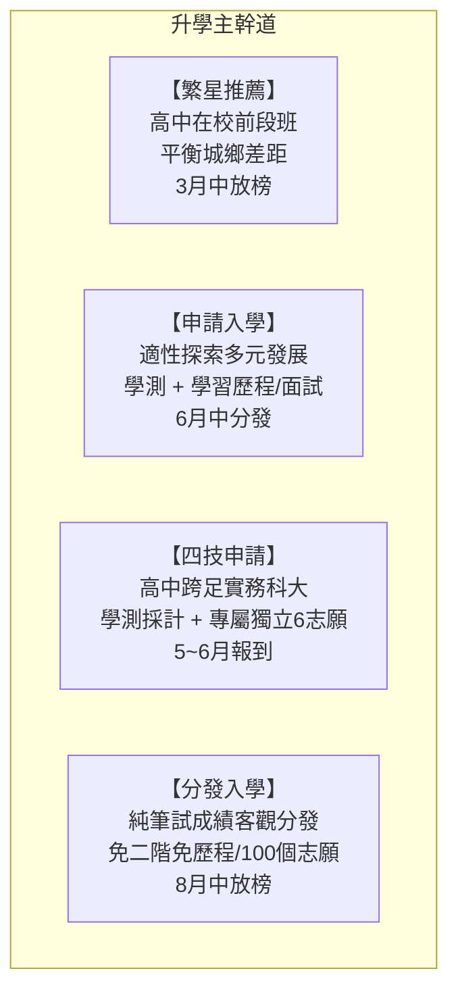
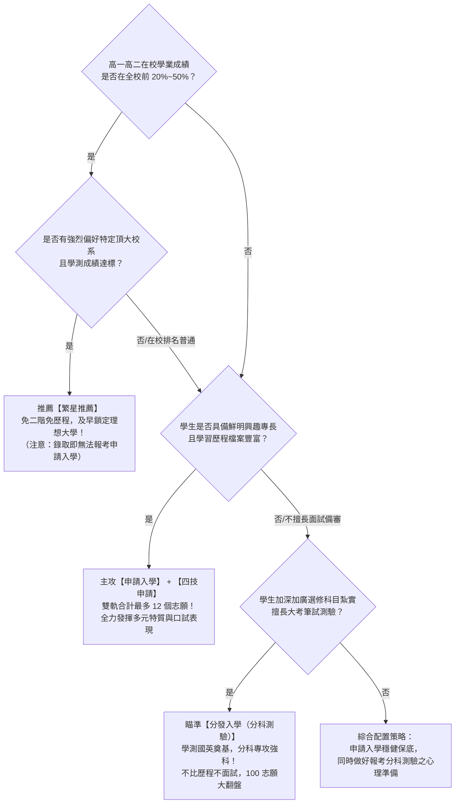

# 高中升大學四大主流管道全景深度對照（116學年度）

> **適用學年度**：116 學年度（分發入學依主管機關最新核定規範編譯）  
> **涵蓋管道**：大學繁星推薦｜大學申請入學｜科技校院四技申請｜大學分發入學  
> **相關頁面**：
> - 管道總則：[繁星推薦](../channels/star.md)｜[申請入學](../channels/application.md)｜[四技申請](../channels/tech_application.md)｜[分發入學](../channels/distribution.md)
> - 核心規則：[大考中心測驗機制](../rules/entrance_examinations.md)｜[跨管道排他與放棄限制](../rules/channel_restrictions.md)｜[分發登記與同分參酌](../rules/distribution_placement.md)｜[二階學習歷程規範](../rules/learning_portfolio_second_stage.md)

---

## 1. 四大管道核心定位與設計理念

臺灣現行高中升大學體系採多元入學架構，每個管道皆有其獨立的政策目的與人才選拔機制：

---

## 2. 四大升學管道綜合橫向比較大表

| 比較維度 | 1. 大學繁星推薦 | 2. 大學申請入學 | 3. 科技校院四技申請 | 4. 大學分發入學 |
| :--- | :--- | :--- | :--- | :--- |
| **主辦單位** | 大學甄選入學委員會 | 大學甄選入學委員會 | 技專校院招生委員會聯合會 | 大學考試入學分發委員會 |
| **適用對象** | 高中全程在校應屆畢業生 | 高中畢業生及同等學力者 | 普通高中學生及綜高學術學程生 | 高中畢業生及同等學力者 |
| **志願數量上限** | **限填 1 所大學 1 個學群**（可選該學群內多系，依大學限制） | **至多 6 個校系** | **至多 6 個科大系組** （與大學 6 志願各自獨立！） | **至多 100 個志願** |
| **在校成績門檻** | **極高**（高一高二在校前 20%、30%、40% 或 50%） | 僅作為二階審查在校成績證明參考 | 僅作為二階備審參考 | **完全不採計** |
| **主要採計考試** | 學測（檢定與比序）、英聽檢定 | 學測（一階篩選與二階加權）、英聽檢定 | 學測（一階篩選與二階加權，最多 4 科）、英聽檢定 | **分科測驗（至少1科）** + **學測轉 60 級分（至多4科）** |
| **有無第二階段甄試** | **第 1~7 類：無**（直接分發放榜） **第 8 類（醫牙）：有**（須面試） | **有**（各大學自辦面試、筆試、實作） | **有**（各科大自辦面試、實作或審查） | **完全沒有二階甄試** （純電腦比分分發） |
| **學習歷程檔案採計** | **完全不採計** | **關鍵採計**（二階綜合審查佔比 $\ge 50\%$） | **關鍵採計**（第二階段備審審查） | **完全不採計** |
| **放榜時程** | 每年 **3 月中旬**（第 1~7 類） 每年 **6 月初**（第 8 類） | 每年 **6 月中旬** 統一分發放榜 | 每年 **5 月下旬 ~ 6 月初** 各校放榜與報到 | 每年 **8 月中旬** 統一放榜 |
| **錄取後排他性** | **極強**：第 1~7 類錄取者，**無論放棄與否一律禁報申請入學**！ | 經統一分發錄取者，未在時限內放棄**不得參加分發入學** | 已報到且未放棄者，**不得參加大學分發入學** | 分發放榜即為當屆聯招最終結果 |

---

## 3. 升學管道選擇決策樹（家長與學生自我評估）

家長可依照孩子的「在校排名」、「考試特性」與「個人性向」循序決策：

---

## 4. 四大管道適合學生類型深度剖析

### 1. 繁星推薦：適合「三年穩紮穩打、平時不偏科」的穩定型學生
- **優勢**：
  - 3 月中即確定大學，高三下可提前安排自主學習、大學先修先修課或外語進修。
  - 完全不用準備第二階段學習歷程檔案與口試面試，心理壓力最小。
- **風險與限制**：
  - 一旦分發錄取第 1~7 類，**無論放棄與否都不得報名當屆申請入學**。因此，繁星所填寫的校系「一定要是考生真正真心願意就讀的科系」，千萬不可為了「有學校念」而隨便填寫！

### 2. 申請入學：適合「性向明確、溝通表達佳、歷程充實」的多元型學生
- **優勢**：
  - 志願共有 6 個，選校選系彈性大。
  - 能藉由學習歷程、課外活動、競賽心得、自述與面試逆轉學測成績的微小差距。
- **風險與限制**：
  - 3 月底通過一階後，4~5 月需同時準備二階審查資料與各校面試，對高三課業與生活節奏衝擊大。
  - 面試可能強碰黃金週，需提前做好行程調度。

### 3. 四技申請：適合「講求務實就業、對工程科技/醫護/設計有熱情」的跨界型學生
- **優勢**：
  - **額外 6 個志願**，完全不佔用一般大學申請入學的 6 個志願扣額。
  - 臺科大、北科大、雲科大、高科大及知名私立醫護科大，在產業界聲譽極佳、就業起薪高、產學合作深厚。
- **風險與限制**：
  - 錄取報到後若想參加 7 月分發，必須依限向錄取科大提出書面放棄。

### 4. 分發入學：適合「大考實戰型、選修學科強、不善面試或備審薄弱」的衝刺型學生
- **優勢**：
  - 完全憑實力分數講話，無任何面試、口試、書審的人為主觀變數。
  - 繁星與申請名額未足額錄取者全數回流分發，名額充裕。
  - 100 個志願空間極大，容錯率最高。
- **風險與限制**：
  - 需持續奮戰至 7 月中旬分科測驗與 8 月中放榜，整個高三下學期需維持高度專注與自律，考驗學生的心理素質。
