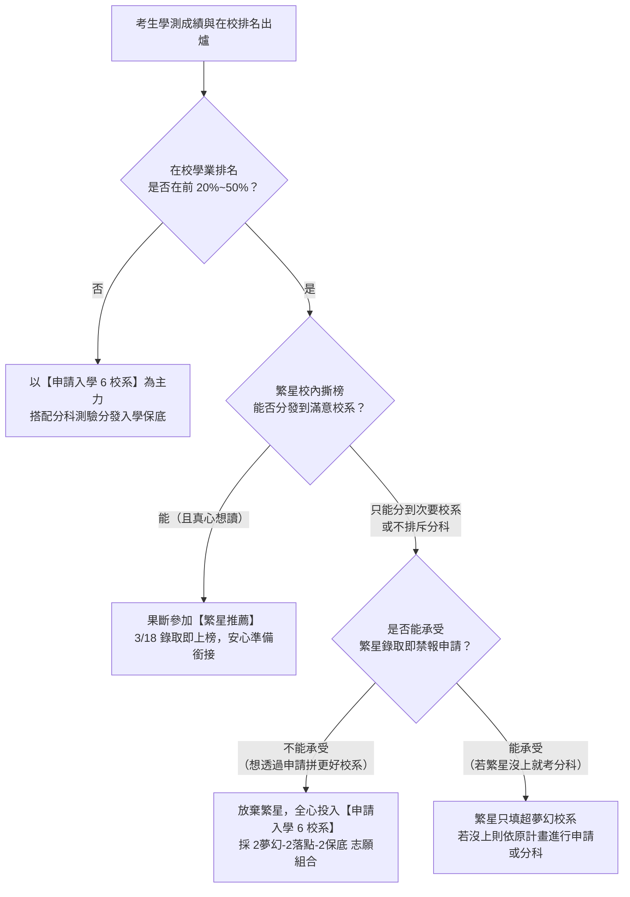

# 大學繁星推薦 vs 申請入學：制度對照與雙軌選填策略（116學年度）

> **適用學年度**：116 學年度  
> **資料來源**：
> - `raw/116學年度大學繁星推薦招生簡章總則.pdf`
> - `raw/116學年度大學申請入學招生簡章總則.pdf`  
> **相關頁面**：[大學繁星推薦總則](../channels/star.md)｜[大學申請入學總則](../channels/application.md)｜[四大管道全景比較](all_channels_overview.md)｜[跨管道排他與放棄限制](../rules/channel_restrictions.md)｜[統一分發機制](../rules/unified_distribution.md)

---

## 1. 制度定位與核心價值比較

繁星推薦與申請入學為高中升大學最主要的兩大多元入學管道，兩者在設計理念、評量指標與遊戲規則上存在根本差異：

| 比較維度 | 大學繁星推薦（Star） | 大學申請入學（Personal Application） |
| :--- | :--- | :--- |
| **核心理念** | 落實就近入學、縮小城鄉落差、平衡區域發展 | 適性揚才、學生自主探索、大學專業多元選才 |
| **報名主體** | **高中學校統一推薦**（每生限推薦一校一學群） | **學生個人自主報名**（可跨校自由選填） |
| **報名資格** | 限 115 學年度高中應屆畢業生，且在校排名符合校系標準（前 20%~50%） | 應屆、已畢業生或具同等學力者均可報名 |
| **志願數量** | 僅能報名 **1 所大學之 1 個學群**（可選填該學群內多系） | 每生至多報名 **6 所校系**（受各大學校內限制） |
| **評量關鍵** | **高一至高三上在校學業成績全校排名百分比（%）**為首要比序 | **學測級分檢定與倍率篩選**為一階門檻；**學習歷程與二階甄試**為二階關鍵 |
| **第二階段甄試** | **第 1~7 類免甄試**（直接放榜分發）；第 8 類（醫牙）須面試 | **全面辦理二階甄試**（學習歷程審查、面試、筆試、實作） |
| **放榜時程** | **116 年 3 月 18 日**（第 1~7 類直接錄取） | **116 年 6 月 10 日**（經二階甄試後統一分發） |
| **對後續管道排他性** | **極強**：第 1~7 類一旦錄取，**無論放棄與否一律禁報申請入學** | 分發錄取後若欲考 7 月分發入學，須於 6/10~6/13 聲明放棄 |

---

## 2. 兩大管道關鍵機制深層對照

### 2.1 篩選與比序邏輯對照
- **繁星推薦**：
  $$\text{學測檢定門檻} \longrightarrow \text{第一比序：在校成績全校排名 \%} \longrightarrow \text{第二至後續比序：學測級分 / 單科在校排名}$$
  - *第一輪分發關鍵保護*：各大學在第 1~3 類學群對同一推薦高中**共僅錄取 1 名**。
- **申請入學**：
  $$\text{學測/英聽/APCS 檢定} \longrightarrow \text{倍率篩選（由高倍率至低倍率）} \longrightarrow \text{同級分超額篩選} \longrightarrow \text{二階綜合評量}$$
  - *全國競爭*：各高中考生在同一池中純粹依學測成績倍率比拼，無單校名額保障。

### 2.2 審查資料與二階負擔對照
- **繁星推薦（第 1~7 類）**：完全零備審、零面試壓力。3 月中即確定大學，可提早規劃高三下自主學習與大學先修。
- **申請入學**：
  - 需上傳高一至高三「學習歷程檔案」（修課紀錄、課程學習成果至多 3 件、多元表現至多 10 件、多元表現綜整心得 ≤800 字/≤3 張圖、自述）。
  - 需準備面試、筆試或術科實作，並承受 5 月甄試「黃金週」的交通與時間壓力。

---

## 3. 升學諮詢雙軌選填策略決策矩陣

### 3.1 適合走「繁星推薦」的學生特質
1. **在校排名頂尖（前 1%~15%）**：具有優先撕榜權，能以低於申請入學的學測分數跨入更高一級的大學校系（「繁星紅利」）。
2. **學測單科失常但總體在校表現穩定者**：只要通過校系檢定標，在第一比序（% 數）極具競爭力。
3. **不擅長面試或無充份學習歷程積累者**：第 1~7 類免甄試直接分發，避開個人特質面試與書審弱點。
4. **目標校系非常明確且確定不反悔者**：因繁星錄取即綁定，不得參加申請入學。

### 3.2 適合走「申請入學」的學生特質
1. **明星高中或在校成績排名中後（>30%~50%）**：繁星比序無優勢，但在全國學測分數具競爭力。
2. **志願多元、想跨校多方嘗試者**：享有 6 個校系自主組合權利。
3. **多元表現、競賽、專題成果亮眼者**：在 108 課綱學習歷程檔案審查中能展現高度個人特色與潛力。
4. **抗壓性高、善於表達與面試者**：能在二階甄試中逆轉學測分數劣勢。

---

## 4. 常見諮詢策略盲點與避坑指南

1. **盲點一：拿繁星當「買保險」，錄取後又後悔**：
   - 許多考生誤以為繁星第 1~7 類錄取後，如果不滿意只要放棄就可以去報申請入學。
   - **法規真相**：繁星錄取生即便在 3/22 前聲明放棄，**依然絕對不得報名申請入學**，只能直接轉戰 7 月分科測驗！若非真心想讀的校系，切勿填入繁星推薦。
2. **盲點二：繁星第八類（醫牙）與申請入學撞系**：
   - 通過繁星第八類一階篩選之考生，在申請入學報名時**不得報名同校醫牙系**。
   - 輔導建議：申請入學的 6 個名額應分散至其他醫學大學或非醫牙之生物科技/二類組頂尖科系作為策略搭配。
3. **盲點三：忽視四技申請（科大）的平行機會**：
   - 一般高中生除大學申請入學 6 校系外，還可另外報名「科技校院日間部四年制申請入學（四技申請）」最多 5 個校系，合計最多有 11 個申請志願可供策略佈局（註：繁星第 1~7 類錄取生同樣不得參加科大申請一階）。
