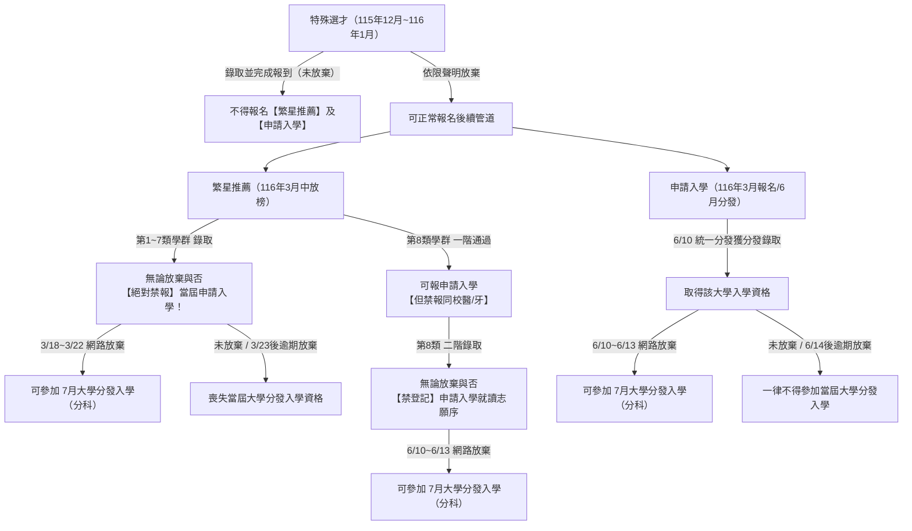

# 大學多元入學跨管道排他與放棄限制規範（116學年度）

> **適用學年度**：116 學年度（分發入學依主管機關最新核定規範編譯）  
> **資料來源**：
> - `raw/116學年度大學繁星推薦招生簡章總則.pdf`（第 4、8、9、11 頁，第四、十、十三、十四、十六條）
> - `raw/116學年度大學申請入學招生簡章總則.pdf`（第 2、5、14、16~17 頁，第二、八、十三、十四條）
> - `raw/116學年度科技校院日間部四年制申請入學聯合招生簡章總則.pdf`（第 2、13~14 頁）
> - `raw/115學年度大學分發入學招生簡章總則.pdf`（第 10 頁，前置管道排他條款）  
> **相關頁面**：
> - 管道總則：[繁星推薦](../channels/star.md)｜[申請入學](../channels/application.md)｜[四技申請](../channels/tech_application.md)｜[分發入學](../channels/distribution.md)
> - 核心規則：[統一分發與志願登記機制](unified_distribution.md)｜[分發入學登記與同分參酌](distribution_placement.md)｜[大考中心測驗機制](entrance_examinations.md)
> - 綜合比較：[繁星 vs 申請比較](../comparisons/star_vs_application.md)｜[四大管道全景比較](../comparisons/all_channels_overview.md)

---

## 1. 跨管道牽制核心原則
臺灣大學多元入學架構（特殊選才、繁星推薦、申請入學、分發入學，以及科技校院各管道）設有嚴密且具法律約束力的排他與報名限制。
其核心精神在於：
1. **防止名額囤積與虛占**：避免少數優秀考生同時取得多個管道之入學資格，導致其他考生權益受損及大學大量缺額。
2. **入學資格確定性**：各階段一經錄取並取得入學資格，若未依法定時程與程序完成「網路聲明放棄」，即視為確定入學，後續各管道全面封閉。
3. **不可逆性**：各管道之網路聲明放棄程序一旦完成確認，一律不得以任何理由要求撤回。

---

## 2. 升學管道時間軸與排他連鎖機制

---

## 3. 各管道前置排他與資格限制

### 3.1 特殊選才錄取之限制
經「116 學年度大學辦理特殊選才招生計畫」或「116 學年度科技校院四年制及專科學校二年制特殊選才入學聯合招生」錄取並完成報到者：
- **未依限放棄入學資格者**：**一律不得報名「繁星推薦」及「申請入學」**。

### 3.2 科技校院（科大）繁星與大學繁星之雙重報名禁令
- 推薦學校對同一學生，**僅得擇一推薦報名**「大學繁星推薦」或「科技校院繁星計畫聯合推薦甄選入學」。
- **重複推薦處罰**：凡重複推薦報名者，一經查出，**即取消大學繁星推薦之錄取資格**。

---

## 4. 繁星推薦錄取後的強烈排他性

### 4.1 第一類至第七類學群錄取生（絕對排他條款）
- **簡章法定條文**：
  > 分發錄取生即取得各該校系之入學資格，**無論放棄與否，一律不得報名**當學年度大學「申請入學」及參加「科技校院日間部四年制申請入學聯合招生」第一階段篩選。
- **實務解析**：
  - 一旦於 3/18 繁星放榜獲得第 1~7 類錄取，考生申請入學的大門即刻完全關閉。
  - **即使考生在 3/22 前完成網路聲明放棄，依然不可報名申請入學！** 此時考生的唯一聯招出路為 7 月之「大學分發入學（分科測驗）」。

### 4.2 第八類學群（醫學系、牙醫學系）排他規範
1. **通過第一階段篩選後**：
   - 通過醫學系一階篩選者，報名申請入學時，**不得再報名同一所大學之醫學系**。
   - 通過牙醫系一階篩選者，報名申請入學時，**不得再報名同一所大學之牙醫學系**。
   - *（容許範圍：仍可報名他校之醫學系、牙醫系，或該大學之其他非醫牙學系）*。
2. **第二階段正式錄取後**：
   - 繁星第八類錄取生，**無論放棄與否，一律不得參加當學年度大學「申請入學」網路就讀志願序登記，接受統一分發**。

---

## 5. 網路聲明放棄入學資格之法定時限與效力

若欲參加 7 月之「大學分發入學（分科測驗分發）」或「科技校院四年制及專科學校二年制日間部聯合登記分發入學」，**必須在法定期限內於甄選會網站完成網路聲明放棄**：

| 入學管道與身分 | 法定網路放棄時程 | 放棄登錄平台 | 依限放棄之效果 | 未依限放棄／逾期放棄之後果 |
| :--- | :--- | :--- | :--- | :--- |
| **繁星第 1 至 7 類錄取生** | **116/3/18 ~ 3/22** （每日 9:00~21:00） | 甄選委員會網站「繁星推薦」專區 | 可報名 7 月分發入學及科大登記分發；但**仍不得報名申請入學** | **一律不得參加**分發入學及科大日間部登記分發。3/23 起向大學放棄者同樣喪失資格。 |
| **繁星第 8 類（醫牙）錄取生** | **116/6/10 ~ 6/13** （每日 9:00~21:00） | 甄選委員會網站「繁星推薦」專區 | 可報名 7 月分發入學及科大登記分發；但**不得參加申請入學統一分發** | **一律不得參加**分發入學及科大日間部登記分發。6/14 起向大學放棄者同樣喪失資格。 |
| **申請入學統一分發錄取生** | **116/6/10 ~ 6/13** （每日 9:00~21:00） | 甄選委員會網站「申請入學」專區 | 可報名 7 月分發入學及科大登記分發 | **一律不得參加**分發入學及科大日間部登記分發。6/14 起向大學放棄者同樣喪失資格。 |
| **科技校院四技申請錄取生** | 各科大簡章規定之放棄期限前（約 6 月中旬） | 填具簡章附表逕向**錄取科技校院**辦理書面放棄 | 可報名 7 月分發入學及科大登記分發 | 已辦理報到且未完成放棄者，**一律取消大學分發入學登記與錄取資格**。 |

### 放棄手續注意事項
1. **完成確認表存檔**：大學甄選會網路放棄後，系統即產生「完成聲明放棄入學資格確認表」，考生應自行列印存檔，作為爭議申訴憑據。四技申請則務必取得錄取科大之放棄受領證明。
2. **手續不可逆**：網路放棄或書面放棄一旦確認送出，**一律不得以任何理由撤回**。
3. **逾期特殊事由放棄（罰則）**：逾期（繁星 3/23 起、申請 6/14 起）因特殊事由欲放棄者，必須逕向錄取大學辦理，但**法規明定一律不得再參加當學年度大學分發入學及科大登記分發**。

---

## 6. 大學分發入學前置排他之 13 項招生管道清單

依據考分會簡章總則明文規定，參加 7 月大學分發入學登記分發者，**絕對不得具有下列 13 項升學管道之錄取報到身分**（若曾獲錄取，必須已依各該管道規定於期限內完成聲明放棄並取得證明）：

1. 大學特殊選才
2. 大學繁星推薦（第 1~7 類於 3 月中前網路放棄；第 8 類於 6 月中前網路放棄）
3. 大學申請入學（於 6 月中前網路放棄）
4. 科技校院四年制及專科二年制特殊選才
5. 科技校院技優甄審入學
6. 科技校院甄選入學
7. 科技校院日間部四年制申請入學（四技申請，依各科大規定期限放棄）
8. 科技校院繁星計畫聯合推薦甄選
9. 身心障礙學生升學大專校院甄試
10. 運動成績優良學生甄審甄試
11. 師資保送甄試
12. 原住民及離島地區醫事人員養成計畫公費生甄試
13. 軍事學校正期班甄選入學

> **罰則警告**：凡未辦理放棄手續而具備上述管道錄取資格者，考分會與教育部查核比對後，**一律取消其大學分發入學之錄取與入學資格**，絕不寬貸。

---

## 7. 跨管道排他限制情境綜合對照表

| 考生現狀情境 | 是否可報申請入學？ | 是否可登記申請志願序？ | 是否可參加大學分發入學（分科）？ |
| :--- | :---: | :---: | :---: |
| **特殊選才錄取並報到，且未放棄** | ❌ 絕對不可 | ❌ 不適用 | ❌ 不可 |
| **繁星第 1~7 類 錄取且未放棄** | ❌ 絕對不可 | ❌ 絕對不可 | ❌ 絕對不可 |
| **繁星第 1~7 類 錄取並於 3/22 前法定放棄** | ❌ **仍不可報名** | ❌ 不適用 | ✔️ **可以參加** |
| **繁星第 8 類 通過一階篩選** | ⚠️ 可報名，但**禁報同校醫/牙** | ✔️ 若二階未錄取可參加 | ✔️ 可參加（若未錄取） |
| **繁星第 8 類 錄取且未放棄** | ✔️ （一階時已報名） | ❌ **不得登記志願序** | ❌ 不可 |
| **繁星第 8 類 錄取並於 6/13 前法定放棄** | ✔️ （一階時已報名） | ❌ 不得登記志願序 | ✔️ **可以參加** |
| **申請入學 正備取但未獲統一分發** | ✔️ 已完成申請 | ⚠️ 已登記但未分發上 | ✔️ **直接可參加**（無須放棄） |
| **申請入學 統一分發錄取且未放棄** | ✔️ 已完成申請 | ✔️ 已分發錄取 | ❌ **絕對不可**（已確定入學） |
| **申請入學 統一分發錄取並於 6/13 前法定放棄** | ✔️ 已完成申請 | ✔️ 已分發錄取 | ✔️ **可以參加** |
| **四技申請 正備取並已向科大報到且未放棄** | ✔️ （已完成申請） | ✔️ （科大獨立報到） | ❌ **絕對不可**（取消分發資格） |
| **四技申請 錄取科大並依限書面聲明放棄** | ✔️ （已完成申請） | ✔️ （科大獨立報到） | ✔️ **可以參加** |
