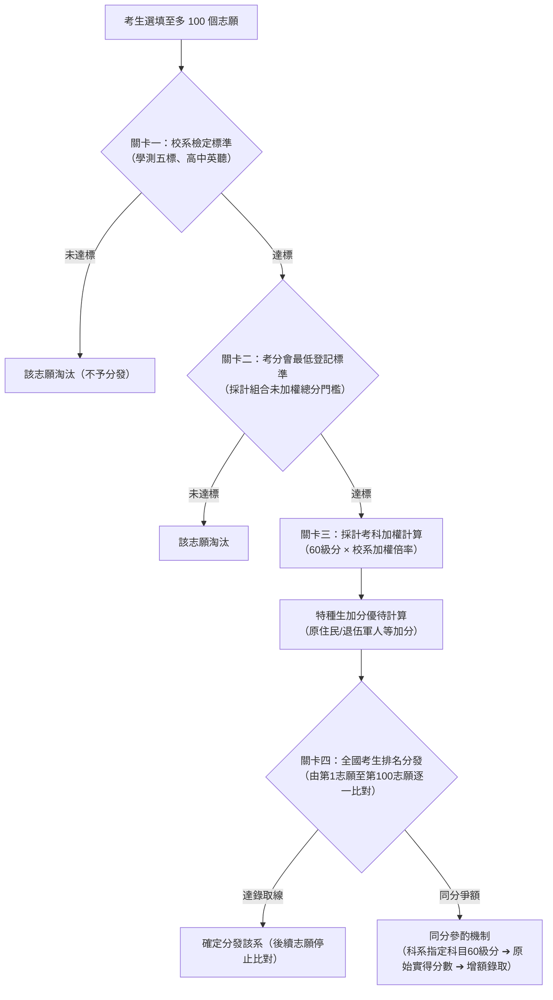
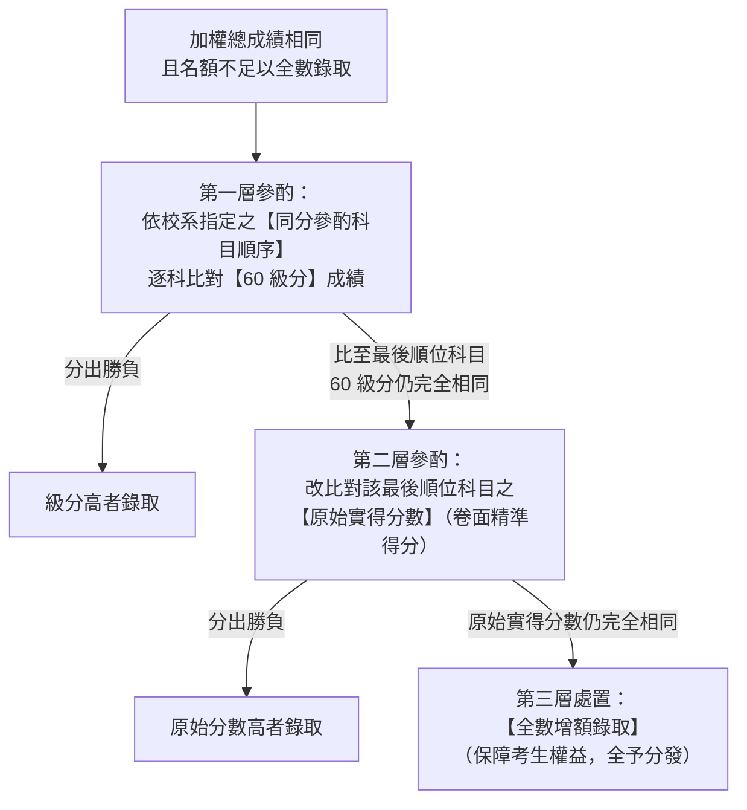

# 大學分發入學登記、採計加權與同分參酌機制（115~116學年度）

> **適用學年度**：現行依主管機關最新核定之 **115 學年度簡章總則** 為基準，供 116 學年度家長與考生掌握作業邏輯。  
> **主管單位**：大學招生委員會聯合會（招聯會）  
> **主辦分發單位**：大學考試入學分發委員會（考分會）  
> **資料來源**：`raw/115學年度大學分發入學招生簡章總則.pdf`（大學考試入學分發委員會）  
> **相關頁面**：[大學分發入學總則](../channels/distribution.md)｜[大學入學測驗機制](entrance_examinations.md)｜[跨管道排他與放棄限制](channel_restrictions.md)｜[四大管道全景比較](../comparisons/all_channels_overview.md)

---

## 1. 分發入學作業全貌與分發四關卡

大學分發入學完全摒棄面試與審查資料，採全自動電腦客觀分發。考生選填之志願在電腦系統中依序通過以下「四大關卡」：

---

## 2. 檢定標準與最低登記標準（入門門檻）

### 2.1 校系檢定標準（篩選前提）
- 各大學校系得訂定「高中英聽測驗等級（A、B、C 級）」及「至多 2 科學測考科之五項標準（頂標、前標、均標、後標、底標）」作為分發檢定標準。
- 考生若有任一項檢定科目未達標準，電腦分發系統即直接排除該志願，不予分發。

### 2.2 考分會「最低登記標準」（避免無效志願）
- 大學分發入學採計考科組合眾多（約數十種不同考科排列組合）。
- 考分會於志願選填前，統一公布各採計科目組合之「最低登記標準」：
  - 以該組合內各科「60 級分制未加權」之成績加總計算。
  - 考生於該科目組合之未加權總分，必須達到或超過最低登記標準，系統始允許分發該組合之系組。

---

## 3. 採計考科加權與總分計算

### 3.1 採計科目與加權規則
- 大學校系可自「學測（國、英、數A、數B、社、自）」、「分科測驗（數甲、數乙、歷、地、公、物、化、生）」及「術科考試」中，自由採計 **3 至 5 科**。
- **法定限制**：
  - 分科測驗科目**至少採計 1 科**（音樂系除外）。
  - 學測考科至多採計 4 科。
- **加權倍率選項**：各系得就採計考科訂定不同加權權數：
  - 不加權（$\times 1.00$）
  - 加權 25%（$\times 1.25$）
  - 加權 50%（$\times 1.50$）
  - 加權 75%（$\times 1.75$）
  - 加權 100%（$\times 2.00$）
- **加權總成績公式**：
  $$\text{校系加權總分} = \sum (\text{各採計科目 60 級分} \times \text{該科加權倍率})$$

---

## 4. 特種身分生加分優待規範

簡章針對具法定特種身分之考生，訂有加分優待辦法：

| 特種生類別 | 證明文件審查期間 | 加分優待比例與標準 | 錄取名額計算方式 |
| :--- | :--- | :--- | :--- |
| **退伍軍人** | 每年 6 月向考分會申請審查 | 依退伍年限及服役性質，加總分 **5% 至 25%** 不等 | 以外加名額（原核定名額 2%）錄取為原則 |
| **原住民學生** | 每年 6 月向考分會申請審查 | 通過族語認證加 **35%**；未通過族語認證加 **10%** | 以外加名額（原核定名額 2%）錄取 |
| **派外人員子女** | 每年 6 月向考分會申請審查 | 依駐外年資與教育部核准函加分 **10% 至 25%** | 外加名額錄取 |
| **蒙藏生 / 僑生** | 每年 6 月向考分會申請審查 | 依主管機關核定標準加分 | 外加名額錄取 |

---

## 5. 終極比序：同分參酌與增額錄取機制

當某校系分發至最後一名招生名額時，若有多位考生的「加權總成績」完全相同，電腦分發系統依下列嚴格法規順序進行「同分參酌」：

### 關鍵家長提醒
1. **60 級分先比，同分才比原始分**：
   - 校系簡章明列之「同分參酌順序一、順序二、順序三」先比的是該科的 **60 級分**。
   - 只有當比到最後一個指定科目，雙方 60 級分仍無法分出勝負時，大考中心系統才會調出當初閱卷的**原始卷面分數**（小數點精度）來決勝負。
2. **絕無黑箱抽籤**：
   - 最終若連卷面原始分數都奇蹟般完全相同，法規明文規定**一律增額錄取**，絕不會透過隨機抽籤淘汰任何考生。

---

## 6. 家長選填 100 個志願之黃金配比策略

1. **「夢幻、穩健、保底」三層戰略配比**：
   - **夢幻衝刺（30 個）**：往年錄取加權分數高於自己預估落點 3~10 分以內的校系，利用名額回流波動大膽下注。
   - **穩健落點（40 個）**：往年錄取分數在自己落點正負 3 分範圍內之志願，為主要錄取核心區間。
   - **安全保底（30 個）**：往年錄取分數低於自己落點 5~15 分以上之系所，確保 100% 不落榜。
2. **志願序絕對按「真心喜好度」填寫**：
   - 電腦系統永遠由志願 1 往下檢查，一旦命中即分發並停止比對。因此**絕不可把分數較低但自己不喜歡的科系排在喜歡的科系前面**。
